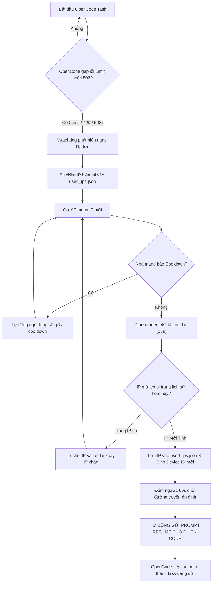

# 🚀 OpenCode Unlimited (Cross-Platform)

> **Giải pháp tự động hóa 100% cho OpenCode AI trên macOS, Linux và Windows.**
>
> Tự động đổi IP khi chạm giới hạn, lọc bỏ các IP trùng lặp trong ngày, tự động chờ cooldown của modem 4G, fake Device ID, và **TỰ ĐỘNG RESUME TIẾP TỤC TASK** mà không cần con người canh bấm tiếp tục.

---

## ✨ Tính Năng Nổi Bật

- ⚡ **Chạy Đúng 1 Lệnh (All-in-One)**: Hoạt động ngay tức thì trên cả **macOS**, **Linux** và **Windows** mà không cần cấu hình phức tạp.
- 🔌 **Local Proxy Bridge Thuần Python**: Tự động chuyển tiếp traffic nội bộ từ `127.0.0.1:28080` sang Upstream Rotating Proxy bằng thư viện chuẩn của Python (`asyncio`). **Không cần cài đặt GOST hay phần mềm bên thứ 3**.
- 🛡️ **Anti-Duplicate IP (Chống Trùng Lặp)**: Tự động lưu vết các IP đã dùng trong ngày (`used_ips.json`). Nếu nhà mạng cấp lại IP cũ đã bị chạm hạn mức, hệ thống sẽ tự động từ chối và tiếp tục đổi sang IP mới tinh.
- ⏰ **Tự Động Reset Theo Ngày Toàn Cầu**: Hệ thống tự động đồng bộ chu kỳ làm mới với OpenCode Gateway lúc **00:00:00 UTC (đúng 7:00 AM giờ Việt Nam)** mỗi ngày.
- ⏳ **Xử Lý Cooldown Thông Minh**: Tự động bắt thông điệp cooldown của nhà mạng 4G (`Con Xs moi co the doi proxy`), tự đếm ngược và thử lại đúng thời gian.
- 🤖 **Auto-Resume Watchdog (100% Liền Mạch)**: Theo dõi file log OpenCode theo thời gian thực. Ngay khi phát hiện lỗi (`Free usage limit reached`, `429`, `503`, `QuotaExceeded`, `ECONNRESET`), hệ thống tự đổi IP, chờ 60 giây ổn định đường truyền rồi tự động gửi prompt tiếp tục phiên code đang làm dở.
- 🔑 **Cross-Platform Device ID Spoofer**: Tự động tạo và làm mới Device ID / Machine UUID ngẫu nhiên tương thích trên macOS, Linux và Windows.

---

## 🚀 Hướng Dẫn Sử Dụng (Chạy Đúng 1 Lệnh)

### 1. Trên macOS & Linux

Mở Terminal và chạy đúng 1 dòng lệnh sau:

```bash
curl -fsSL https://raw.githubusercontent.com/coder-nguoi-tay/opencode-unlimited/main/install.sh | bash
```

Hoặc nếu đã clone repository:

```bash
./run.sh
```

*(Lệnh trên sẽ tự động tạo lối tắt toàn cục `opencode-unlimited`. Lần sau bạn chỉ cần gõ `opencode-unlimited` ở bất kỳ thư mục nào).*

---

### 2. Trên Windows (PowerShell / Command Prompt)

Mở **PowerShell** và chạy 1 dòng lệnh sau:

```powershell
irm https://raw.githubusercontent.com/coder-nguoi-tay/opencode-unlimited/main/install.ps1 | iex
```

Hoặc nếu đã tải về, bạn chỉ cần **click đúp vào file `run.bat`**.

---

## ⚙️ Cấu Hình (`config.json`)

Trong lần chạy đầu tiên, hệ thống sẽ tự động hỏi bạn API Key và Upstream Proxy nếu chưa có file cấu hình. Bạn cũng có thể chủ động chỉnh sửa file `config.json`:

```json
{
  "api_url": "https://proxyxoay.shop/api/get.php?key=YOUR_API_KEY",
  "upstream_proxy": "160.250.166.20:10427",
  "local_port": 28080,
  "cooldown_extra_seconds": 2,
  "stabilize_wait_seconds": 60,
  "max_dedup_attempts": 10,
  "auto_resume": true,
  "prompt_resume_text": "Tiếp tục thực hiện các bước tiếp theo trong công việc đang làm dở."
}
```

### Giải thích các tham số:
| Tham số | Ý nghĩa |
| :--- | :--- |
| `api_url` | Đường link gọi xoay IP (ví dụ từ `proxyxoay.shop`) |
| `upstream_proxy` | Địa chỉ IP:Port của Proxy xoay mà nhà cung cấp cấp cho bạn |
| `local_port` | Cổng HTTP Proxy nội bộ (mặc định: `28080`) |
| `cooldown_extra_seconds` | Số giây chờ thêm sau khi hết cooldown của nhà mạng để đảm bảo kết nối |
| `stabilize_wait_seconds` | Số giây chờ IP mới ổn định trước khi tự động Resume (mặc định: `60`s) |
| `max_dedup_attempts` | Số lần thử đổi IP tối đa nếu gặp phải IP trùng lặp |
| `auto_resume` | `true`: Tự động gửi lệnh tiếp tục task dang dở sau khi đổi IP |
| `prompt_resume_text` | Câu lệnh nhắc gửi tới OpenCode để yêu cầu tiếp tục làm |

---

## 🛠️ Các Lệnh Tiện Ích

Chạy trực tiếp với `python3 main.py`:

```bash
# Xem danh sách các IP đã sử dụng trong chu kỳ hôm nay
python3 main.py --list-ips

# Xóa trắng danh sách IP đã lưu (bắt đầu lại chu kỳ mới)
python3 main.py --clear-ips

# Chủ động ép đổi IP mới ngay lập tức
python3 main.py --rotate

# Khởi chạy hệ thống và tự động bật luôn giao diện OpenCode CLI
python3 main.py --launch
```

---

## 🔄 Luồng Hoạt Động Của Hệ Thống



---

## 📋 Yêu Cầu Hệ Thống

- **Hệ điều hành**: macOS (Intel / Apple Silicon), Linux (Ubuntu, Debian, Arch, CentOS...), Windows 10/11.
- **Python**: Phiên bản `>= 3.8` (Sử dụng 100% thư viện chuẩn tích hợp sẵn, không cần `pip install`).

---

## 📄 License & Tác giả

Phát triển bởi **[coder-nguoi-tay](https://github.com/coder-nguoi-tay)**. Mã nguồn mở hoàn toàn theo giấy phép MIT.
