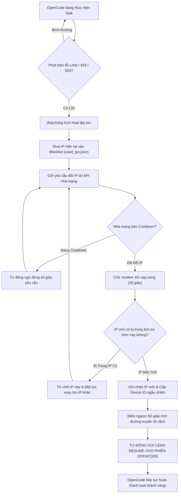

# 🚀 OpenCode Unlimited — Hướng Dẫn Sử Dụng Chi Tiết (Full Manual)

> **Giải pháp tự động hóa 100% dành cho OpenCode AI trên macOS, Linux và Windows.**  
> Tự động phát hiện lỗi hạn mức (`Free usage limit reached`, `429`, `503`, `QuotaExceeded`, `ECONNRESET`), tự động đổi IP sạch mới, lọc bỏ hoàn toàn các IP trùng lặp trong ngày, tự động chờ cooldown của nhà mạng 4G, fake Device ID và **TỰ ĐỘNG GỬI LỆNH TIẾP TỤC TASK ĐANG LÀM DỞ** mà không cần con người ngồi canh hay bấm tay.

---

## 📑 Mục Lục

1. [Vấn Đề & Giải Pháp](#-vấn-đề--giải-pháp)
2. [Tính Năng Nổi Bật](#-tính-năng-nổi-bật)
3. [Cài Đặt & Chạy Siêu Tốc (Chỉ 1 Lệnh)](#-cài-đặt--chạy-siêu-tốc-chỉ-1-lệnh)
   - [Dành cho macOS](#1-dành-cho-macos-apple-silicon--intel)
   - [Dành cho Linux](#2-dành-cho-linux-ubuntu-debian-arch-fedora)
   - [Dành cho Windows](#3-dành-cho-windows-10--11)
4. [Hướng Dẫn Cấu Hình Proxy (`config.json`)](#-hướng-dẫn-cấu-hình-proxy-configjson)
5. [Hướng Dẫn Sử Dụng Hàng Ngày](#-hướng-dẫn-sử-dụng-hàng-ngày)
6. [Các Lệnh Tiện Ích & Quản Trị](#-các-lệnh-tiện-ích--quản-trị)
7. [Sơ Đồ Hoạt Động (Architecture Flow)](#-sơ-đồ-hoạt-động-architecture-flow)
8. [Cài Đặt Chạy Ẩn Như Service Nền (Persistent Daemon)](#-cài-đặt-chạy-ẩn-như-service-nền-persistent-daemon)
9. [Câu Hỏi Thường Gặp (FAQ & Troubleshooting)](#-câu-hỏi-thường-gặp-faq--troubleshooting)

---

## 🎯 Vấn Đề & Giải Pháp

| Vấn Đề Khi Dùng OpenCode Thường | Giải Pháp Của OpenCode Unlimited |
| :--- | :--- |
| **Bị ngắt quãng khi hết lượt free**: Đang code dở thì OpenCode văng thông báo `You've used today's free messages`, buộc người dùng phải dừng việc. | **Tự động bắt lỗi thời gian thực**: Watchdog nhận diện lỗi trong tích tắc và lập tức kích hoạt luồng xử lý tự động. |
| **Phải thao tác thủ công**: Người dùng phải tự đổi IP, tự chờ mạng ổn định rồi bấm tiếp tục prompt bằng tay. | **Tự động 100% không cần người canh**: Tự đổi IP, tự chờ 60s cho mạng ổn định rồi **tự động gửi lệnh tiếp tục task** vào phiên làm việc hiện tại. |
| **Xoay trúng IP cũ bị cạn quota**: Pool 4G của nhà mạng thường cấp lại các IP đã dùng trước đó, dẫn đến vừa đổi IP xong vẫn bị lỗi limit. | **Bộ lọc chống trùng lặp (`used_ips.json`)**: Ghi nhớ mọi IP đã dùng trong ngày. Nếu nhà mạng cấp lại IP cũ, hệ thống tự từ chối và xoay tiếp đến khi có IP mới tinh. |
| **Lỗi Cooldown nhà mạng**: Gọi API đổi IP liên tục sẽ bị nhà mạng từ chối (`Con 30s mới có thể đổi proxy`). | **Xử lý Cooldown thông minh**: Tự phân tích số giây cooldown cần chờ, ngủ đúng thời gian rồi tự động thử lại. |
| **Cài đặt phức tạp, phụ thuộc nhiều tool**: Cần cài GOST, cấu hình tường lửa, script rườm rà. | **Thuần Python chuẩn (Zero Dependency)**: Hoạt động ngay bằng Python 3.8+ có sẵn, không cần cài thêm bất kỳ thư viện hay phần mềm thứ ba nào. |

---

## ✨ Tính Năng Nổi Bật

- ⚡ **Chạy Đúng 1 Lệnh (All-in-One)**: Hoạt động ngay tức thì trên cả **macOS**, **Linux** và **Windows**.
- 🔌 **Local Proxy Bridge Thuần Python (`bridge.py`)**: Lắng nghe tại `127.0.0.1:28080`, chuyển tiếp trực tiếp sang Upstream Proxy bằng `asyncio`, hỗ trợ cả proxy có xác thực (`user:pass@host:port`). Kết nối chỉ bị đóng khi **cả hai chiều** cùng im lặng quá 90s (response AI stream dài không bị cắt ngang), và khi API xoay IP trả về Upstream proxy mới thì bridge tự chuyển sang dùng nó.
- 🛡️ **Anti-Duplicate IP Engine (`rotator.py`)**: Lọc bỏ IP trùng lặp trong chu kỳ ngày, tự động dọn dẹp lịch sử IP cũ.
- ⚡ **Dynamic Fast Probe**: Giảm thời gian chờ đổi IP modem 4G xuống chỉ 5–15s thay vì 25–45s cố định.
- 🛑 **Smart Circuit Breaker**: Tự động ngắt auto-resume nếu một session vẫn lỗi sau 3 lần tự gửi lệnh tiếp tục liên tiếp, chống vòng lặp vô tận làm lãng phí proxy. "Liên tiếp" nghĩa là mỗi lần lỗi tới trong vòng 10 phút sau lần tiếp tục trước — phiên chạy ổn lâu hơn thì đếm lại từ đầu. Phiên bị khóa được mở lại sau 30 phút.
- ⏱️ **Proactive TTL Rotation**: Chủ động đổi IP mới khi proxy 4G sắp hết hạn sống (< 45s) một cách mượt mà và an toàn. Hạn sống của IP được lưu ra `proxy_state.json` nên **khởi động lại tool vẫn nhớ** khi nào IP sắp chết. Khi OpenCode đã tắt, service nền tự **tạm dừng xoay IP, thăm dò proxy và tự gửi lệnh tiếp tục** (không tốn IP, không đổi Device ID) và chạy tiếp khi OpenCode mở lại; Local Bridge vẫn giữ để mở lại OpenCode là dùng được ngay. Đóng cửa sổ OpenCode Desktop là đủ: tiến trình nền `opencode-cli serve --service` mà Desktop để lại chạy ngầm không được tính là "OpenCode đang mở". Lệnh OpenCode chạy chớp nhoáng (dưới 8s) cũng không được tính, và nếu có lúc không kiểm tra được (máy bận) thì watchdog giữ nguyên trạng thái chứ không tự coi là OpenCode đã mở; dòng log "OpenCode đã mở lại" ghi kèm PID và lệnh của tiến trình làm nó mở lại.
- 🩺 **Proxy Health Monitor**: Khi OpenCode đang mở, cứ 20s tool thăm dò proxy một lần. Proxy không phản hồi 2 lần liên tiếp (IP đã chết) thì **xoay IP ngay**, không đợi OpenCode thử lại `Attempt N - retrying` tới lúc bỏ cuộc. Nếu OpenCode bỏ cuộc đúng lúc đang xoay, lệnh tiếp tục vẫn được gửi ngay khi xoay xong. Xoay thất bại liên tục (VD: key API hỏng) thì tự giãn thời gian thử lại (tối đa 10 phút) để không spam API. Nếu proxy cứ **chết ngay sau mỗi lần xoay** (2 lần liên tiếp chết trong vòng 3 phút sau khi xoay — thường là lỗi phía nhà cung cấp proxy, không nhận kết nối mới) thì tool tạm ngừng tự xoay 5 phút (gấp đôi mỗi lần tái diễn, tối đa 30 phút) và hiện thông báo, để không đốt IP; lỗi OpenCode báo trong log vẫn được xử lý bình thường.
- ⏰ **Đồng Bộ Chu Kỳ Reset Toàn Cầu**: Tự động làm mới danh sách IP theo mốc **00:00:00 UTC (đúng 7:00 AM giờ Việt Nam)** mỗi ngày.
- 🤖 **Auto-Resume Watchdog (`watchdog.py`)**: Tự động bơm prompt tiếp tục phiên code dang dở ngay khi có mạng mới, loại trừ các lỗi false-positive. Lúc khởi động, tool chỉ tự xử lý lỗi gần nhất trong log OpenCode nếu lỗi đó **chưa được xử lý** (mốc lỗi đã thấy được lưu ở `watchdog_state.json` trong thư mục dữ liệu OpenCode) và **chưa quá 10 phút** — khởi động lại tool không còn xoay IP / gửi lệnh tiếp tục lại cho lỗi cũ.
- 🔑 **Cross-Platform Device Spoofer (`spoofer.py`)**: Tự làm mới Machine UUID / IOPlatformUUID ngẫu nhiên.

---

## 🚀 Cài Đặt & Chạy Siêu Tốc (Chỉ 1 Lệnh)

### 1. Dành cho macOS (Apple Silicon & Intel)

Mở ứng dụng **Terminal** và dán đúng một dòng lệnh sau:

```bash
curl -fsSL https://raw.githubusercontent.com/coder-nguoi-tay/opencode-unlimited/main/install.sh | bash
```

> **Ghi chú**: Lệnh trên sẽ tự động tải mã nguồn về thư mục `~/.opencode-unlimited` và tạo một lệnh tắt toàn cục là `opencode-unlimited`. Lần sau, bạn chỉ cần gõ:
> ```bash
> opencode-unlimited
> ```

---

### 2. Dành cho Linux (Ubuntu, Debian, Arch, Fedora)

Mở Terminal và chạy lệnh:

```bash
curl -fsSL https://raw.githubusercontent.com/coder-nguoi-tay/opencode-unlimited/main/install.sh | bash
```

---

### 3. Dành cho Windows (10 & 11)

Mở **PowerShell** (không cần quyền Administrator) và dán dòng lệnh sau:

```powershell
irm https://raw.githubusercontent.com/coder-nguoi-tay/opencode-unlimited/main/install.ps1 | iex
```

> **Cách 2 trên Windows (Không cần gõ lệnh)**:
> 1. Tải toàn bộ repository này về dưới dạng file `.zip` rồi giải nén.
> 2. **Click đúp vào file `run.bat`** là chương trình sẽ tự khởi động.

---

## ⚙️ Hướng Dẫn Cấu Hình Proxy (`config.json`)

Trong lần đầu khởi chạy, chương trình sẽ hiển thị lời nhắc hỏi bạn **Link API Xoay IP** và **Upstream Proxy**.

Bạn cũng có thể mở trực tiếp file `config.json` để chỉnh sửa theo ý mình:

```json
{
  "api_url": "https://proxyxoay.shop/api/get.php?key=YOUR_API_KEY",
  "upstream_proxy": "160.250.166.20:10427",
  "local_port": 28080,
  "cooldown_extra_seconds": 2,
  "stabilize_wait_seconds": 60,
  "max_dedup_attempts": 10,
  "auto_resume": true,
  "prompt_resume_text": "Tiếp tục thực hiện các bước tiếp theo trong công việc đang làm dở."
}
```

### Bảng giải thích chi tiết các tham số:

| Tham số | Ý nghĩa & Hướng dẫn |
| :--- | :--- |
| `api_url` | Đường dẫn API dùng để yêu cầu đổi IP mới do bên bán proxy cấp (ví dụ: `https://proxyxoay.shop/api/get.php?key=...`). |
| `upstream_proxy` | Địa chỉ `IP:PORT` của proxy upstream để máy tính kết nối Internet qua đó (ví dụ: `160.250.166.20:10427`). |
| `local_port` | Cổng Proxy cục bộ mà tool mở trên máy bạn (mặc định: `28080`). OpenCode sẽ kết nối qua cổng này. |
| `cooldown_extra_seconds` | Số giây chờ thêm sau khi hết thời gian cooldown của nhà mạng để đảm bảo kết nối đã sẵn sàng (mặc định: `2`). |
| `stabilize_wait_seconds` | Số giây đếm ngược chờ đường truyền và gateway OpenCode ổn định trước khi tự động gửi lệnh resume (khuyên dùng: `60` giây). |
| `max_dedup_attempts` | Số lần tối đa tool sẽ tiếp tục xoay IP nếu gặp phải IP trùng lịch sử hôm nay (mặc định: `10` lần). |
| `auto_resume` | `true`: Tự động gửi lệnh tiếp tục task cho phiên OpenCode đang mở. `false`: Chỉ đổi IP, không tự gửi lệnh. |
| `prompt_resume_text` | Câu lệnh nhắc nhở gửi cho OpenCode khi kết nối lại thành công. |

---

## 💻 Hướng Dẫn Sử Dụng Hàng Ngày

### Quy trình làm việc đề xuất (Đơn giản nhất):

1. **Bước 1**: Mở một cửa sổ Terminal và gõ lệnh:
   ```bash
   opencode-unlimited
   ```
   *(Cửa sổ này sẽ hiển thị bảng trạng thái màu xanh, giữ vai trò làm cầu nối mạng và giám sát tự động).*
2. **Bước 2**: Mở một tab Terminal khác (hoặc IDE của bạn) và dùng OpenCode như bình thường:
   ```bash
   opencode
   ```
3. **Bước 3**: Cứ thoải mái giao task cho OpenCode code. Khi OpenCode chạm giới hạn limit hoặc bị văng mạng, bạn **không cần làm gì cả**:
   - Tool sẽ tự động đổi sang một IP mới tinh.
   - Tool đếm ngược 60 giây trên màn hình.
   - Tool tự động gửi thông báo desktop và kích hoạt phiên code chạy tiếp tục.

---

## 🛠️ Các Lệnh Tiện Ích & Quản Trị

Bạn có thể chạy các lệnh quản trị này bất kỳ lúc nào:

```bash
# 0. Xem bảng trạng thái hệ thống toàn diện (Proxy, IP hiện tại, Session, Tiến trình)
opencode-unlimited --status

# 1. Xem danh sách tất cả các IP đã dùng trong ngày hôm nay
opencode-unlimited --list-ips

# 2. Xóa sạch danh sách IP đã dùng (khi bạn muốn bắt đầu lại chu kỳ mới)
opencode-unlimited --clear-ips

# 3. Chủ động ép hệ thống xoay sang IP mới ngay lập tức
opencode-unlimited --rotate

# 4. Khởi động Proxy ngầm và tự động bật luôn OpenCode CLI
opencode-unlimited --launch
```

> **Mẹo trên Windows**: Trong thư mục `scripts\windows\`:
> - Chạy ngầm không cửa sổ: Chạy `start-background.vbs`
> - Xem trạng thái nhanh: Chạy `powershell -File scripts\windows\status.ps1`
> - Dừng hệ thống: Chạy `powershell -File scripts\windows\stop-background.ps1` (hoặc thêm `-StopOpenCode` để tắt cả OpenCode). Script chỉ tắt `main.py` / `bridge.py` của đúng thư mục này (được khởi chạy bằng `start-background.vbs` hoặc `run.bat`), không đụng tới project Python khác.
> - Lưu ý: nếu tắt service nền trong khi OpenCode (mở bằng shortcut Proxy) vẫn đang chạy, OpenCode sẽ mất kết nối vì vẫn trỏ vào `127.0.0.1:28080`. Hãy mở lại OpenCode bằng shortcut **OpenCode (Proxy Unlimited)**.

---

## 🔄 Sơ Đồ Hoạt Động (Architecture Flow)



---

## ⚙️ Cài Đặt Chạy Ẩn Như Service Nền (Persistent Daemon)

Nếu bạn muốn tool luôn luôn chạy ngầm mỗi khi bật máy mà không cần mở Terminal:

### Trên macOS (LaunchAgent)

Tạo file `~/Library/LaunchAgents/com.user.opencode-unlimited.plist`:

```xml
<?xml version="1.0" encoding="UTF-8"?>
<!DOCTYPE plist PUBLIC "-//Apple//DTD PLIST 1.0//EN" "http://www.apple.com/DTDs/PropertyList-1.0.dtd">
<plist version="1.0">
<dict>
    <key>Label</key>
    <string>com.user.opencode-unlimited</string>
    <key>ProgramArguments</key>
    <array>
        <string>/usr/bin/python3</string>
        <string>/Users/YOUR_USERNAME/.opencode-unlimited/main.py</string>
    </array>
    <key>RunAtLoad</key>
    <true/>
    <key>KeepAlive</key>
    <true/>
    <key>StandardOutPath</key>
    <string>/tmp/opencode-unlimited.log</string>
    <key>StandardErrorPath</key>
    <string>/tmp/opencode-unlimited.err</string>
</dict>
</plist>
```

Sau đó kích hoạt bằng lệnh:
```bash
launchctl load -w ~/Library/LaunchAgents/com.user.opencode-unlimited.plist
```

---

### Trên Windows (Task Scheduler & Background VBS)

#### Cách 1: Chạy ẩn không cần cửa sổ đen (Khuyên dùng)
- Click đúp vào file scripts\windows\start-background.vbs.
- Khi cần tắt: chạy powershell -ExecutionPolicy Bypass -File scripts\windows\stop-background.ps1.

#### Cách 2: Tự động khởi động ngầm cùng Windows (Khuyên dùng cho máy cá nhân)
- Mở PowerShell trong thư mục project và chạy:
`powershell
powershell -ExecutionPolicy Bypass -File scripts\windows\install-autostart.ps1
`
- Khi muốn gỡ bỏ:
`powershell
powershell -ExecutionPolicy Bypass -File scripts\windows\uninstall-autostart.ps1
`

---

### Trên Linux (Systemd Service)

Tạo file `~/.config/systemd/user/opencode-unlimited.service`:

```ini
[Unit]
Description=OpenCode Unlimited Background Service
After=network.target

[Service]
ExecStart=/usr/bin/python3 %h/.opencode-unlimited/main.py
Restart=always
RestartSec=5

[Install]
WantedBy=default.target
```

Kích hoạt service:
```bash
systemctl --user daemon-reload
systemctl --user enable --now opencode-unlimited
```

---

## ❓ Câu Hỏi Thường Gặp (FAQ & Troubleshooting)

### 1. Tại sao tôi đã đổi sang IP mới tinh mà vẫn bị báo `Free usage limit reached`?
> **Giải thích**: OpenCode thiết lập **Ngân sách dùng thử toàn cầu (Global Daily Quota)** cho toàn bộ cộng đồng trên thế giới. Vào những ngày cao điểm, khi tổng số request miễn phí của toàn bộ người dùng vượt quá ngân sách tài trợ của OpenCode, Cloudflare Gateway sẽ tạm đóng cổng dùng thử trên toàn cầu đối với mọi IP. Cổng này sẽ mở lại vào đúng **00:00:00 UTC (tức 7:00 AM sáng hôm sau giờ Việt Nam)**.  
> 👉 *Khắc phục nếu cần code gấp trong đêm: Hãy gắn thêm API key riêng (như Gemini Flash miễn phí hoặc DeepSeek giá rẻ) vào cấu hình OpenCode.*

### 2. Danh sách IP đã dùng có tự xóa khi sang ngày mới không?
> **Có!** Hệ thống tự động tính toán mốc reset 7:00 AM mỗi ngày. Mọi IP đã dùng của ngày hôm trước sẽ tự động được xem là "sạch" và có thể tái sử dụng vào ngày hôm sau.

### 3. Tool có làm lộ API Key hay IP cá nhân của tôi khi chia sẻ không?
> **Không!** File `.gitignore` đã được cấu hình chặt chẽ để loại trừ `config.json` và `used_ips.json`. Mã nguồn đẩy lên Git chỉ chứa file mẫu `config.example.json` an toàn 100%.

### 4. Tôi dùng proxy có mật khẩu (Username / Password) thì cấu hình thế nào?
> Bạn điền dạng: `"upstream_proxy": "user:pass@host:port"` vào `config.json`.

### 5. OpenCode báo `ECONNRESET: The socket connection was closed unexpectedly` kèm `Attempt N - retrying` là lỗi gì?
> Đây là lỗi mạng, không phải lỗi code: kết nối tới server AI bị cắt giữa chừng, thường do IP 4G vừa hết hạn sống hoặc modem đang đổi IP. OpenCode tự thử lại, còn **Proxy Health Monitor** sẽ phát hiện proxy chết trong khoảng 30s và xoay IP mới, lần thử tiếp theo của OpenCode sẽ chạy qua IP mới.  
> 👉 *Nếu số lần thử cứ tăng mãi: mở `opencode_unlimited.log` xem có dòng `key khong ton tai` hoặc `Lỗi gọi API xoay IP` không — nếu có thì key proxy đã hết hạn/sai, cần cập nhật `api_url` trong `config.json`.*  
> 👉 *Nếu log có dòng `Proxy lại chết chỉ ~60s sau khi xoay`: proxy chỉ nhận kết nối mới khoảng 1 phút sau mỗi lần gọi API xoay rồi từ chối (kết nối cũ vẫn chạy). Đây là lỗi phía nhà cung cấp — hãy kiểm tra lại key/gói proxy với nhà cung cấp.*

---

## 📄 Bản Quyền (License)

Dự án được phát triển và duy trì bởi **[coder-nguoi-tay](https://github.com/coder-nguoi-tay)** dưới giấy phép mã nguồn mở **MIT License**. Bạn có thể thoải mái sử dụng, tùy biến và chia sẻ cho cộng đồng.
